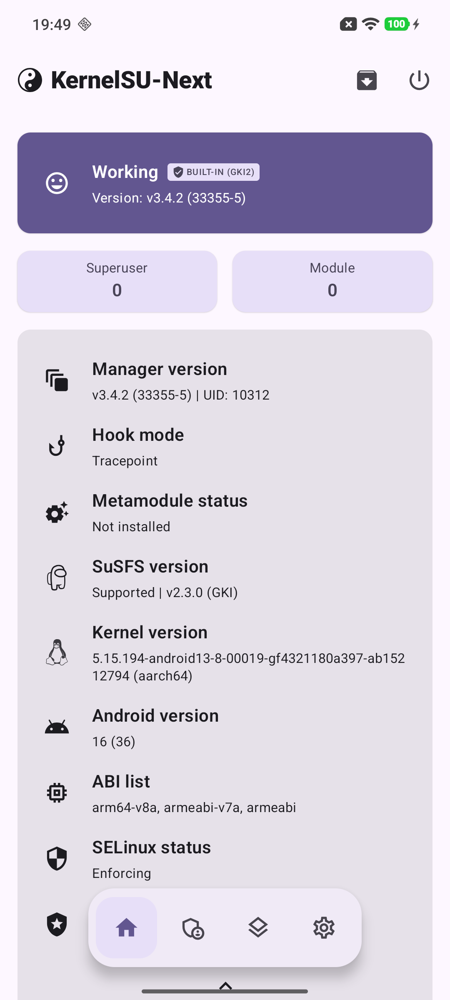

# nuwa-gki-ksu-susfs

[](LICENSE)
[](https://github.com/trivl-dev/nuwa-gki-ksu-susfs/releases/latest)
[](https://github.com/trivl-dev/nuwa-gki-ksu-susfs/actions/workflows/build.yml)

Custom **GKI 5.15.194** kernel for the **Xiaomi 13 Pro (nuwa)** running
**HyperOS 3 Global `OS3.0.303.0.WMBMIXM` (Android 16)**, with
**KernelSU-Next v3.4.2 built in** and **SUSFS as a loadable LKM**.

The kernel is rebuilt from the exact upstream commit Google/Xiaomi used for the
stock kernel, with the stock build config extracted from the device's own
`boot.img`. The result keeps the vendor KMI intact, so every stock module in
`vendor_boot` / `vendor_dlkm` still loads.

> **Flash scope: `boot` only.** `init_boot`, `vendor_boot`, `dtbo`, `vbmeta`
> and `super` are never touched.

---

## Status

| Item | Result |
|---|---|
| Device | Xiaomi 13 Pro (`nuwa`, model `2210132G`, SM8550), HyperOS 3 Global `OS3.0.303.0.WMBMIXM`, Android 16 |
| Kernel | `5.15.194-android13-8-00019-gf4321180a397-ab15212794` |
| Built image | 40,937,984 bytes (`Image`, ARM64, 4K pages) |
| KMI check | **8,575 / 8,585 CRC match `android/abi_gki_aarch64.xml`, 0 mismatch** |
| Stock-module check | **328 vendor modules from `vendor_boot`: 15,092 CRCs, 0 mismatch** |
| On-device | Booted, KernelSU-Next manager reports **33355 / v3.4.2 / Working**, SUSFS LKM loads |

Details, hashes and the full post-mortem: [`docs/BUILD-VERIFIED.md`](docs/BUILD-VERIFIED.md).

### Verified on device

<p align="center">
  
</p>

Captured from a retail Xiaomi 13 Pro running HyperOS 3 Global `OS3.0.303.0.WMBMIXM`:

| Field | Value |
|---|---|
| KernelSU-Next | v3.4.2 (33355-5), **Working**, built-in (GKI2), hook mode `Tracepoint` |
| Kernel | `5.15.194-android13-8-00019-gf4321180a397-ab15212794` (aarch64) |
| SUSFS | Supported, v2.3.0 (GKI) |
| Android | 16 (SDK 36), ABI `arm64-v8a`, `armeabi-v7a`, `armeabi` |
| SELinux | Enforcing |

---

## Why this kernel is different

Most custom kernels for this device are built from a vendor OSS tree or a ROM
tree, which changes the kernel ABI. On a stock HyperOS build that silently
breaks module loading (Wi-Fi, cellular, camera, fingerprint, ...) and usually
ends in a boot loop. This project instead:

1. **Rebuilds the exact GKI commit** — `android13-5.15` @ `f4321180a397`
   (5.15.194). The stock version string embeds that commit hash.
2. **Uses the stock config** — extracted from `boot.img` via `IKCONFIG`
   (`state/stock-5.15.194.config`), not a generic defconfig.
3. **Keeps `DEBUG_INFO_BTF` enabled** — `DEBUG_INFO_BTF_MODULES` adds two fields
   to `struct module`; because genksyms hashes structs transitively, disabling
   BTF changes the CRC of `module_layout` and ~63% of all KMI symbols.
4. **Gates every build on the KMI** — `scripts/verify_kmi_abi.py` compares every
   exported symbol CRC against Google's `android/abi_gki_aarch64.xml` and fails
   the build on a single mismatch.

---

## Requirements

- Linux x86_64 (WSL2 Ubuntu 22.04/24.04 recommended, or native Linux).
- Workspace on a native Linux filesystem (ext4). **Do not build from `/mnt/c`**.
- ~30 GB free, 8 GB+ RAM recommended (7.7 GB works with `-j6` + swap).
- `pahole` (package `dwarves`) — required, BTF cannot be disabled.
- Bootloader unlocked.
- Stock firmware fastboot package (`.tgz`) placed in `firmware/` — not shipped
  here for licensing reasons.

## Quick start

```bash
git clone https://github.com/<you>/nuwa-gki-ksu-susfs.git
cd nuwa-gki-ksu-susfs

bash scripts/00_check_env.sh
bash scripts/01_install_deps.sh          # needs sudo

bash scripts/02_fetch_sources.sh         # ACK @ pin + KernelSU-Next @ v3.4.2
bash scripts/03_fetch_toolchain.sh       # AOSP clang-r536225 + magiskboot

bash scripts/04_build_kernel.sh          # Image + KMI gate  (JOBS_OVERRIDE=6 to force -j)
bash scripts/05_build_susfs_lkm.sh       # susfs_guard_lkm.ko

# put the stock fastboot .tgz in firmware/ first
bash scripts/06_extract_stock_boot.sh    # checksum + extracts boot.img + config
bash scripts/07_repack_boot.sh           # build/nuwa-ksun-susfs_boot_<date>.img
```

Artifacts land in `build/`:

| File | Contents |
|---|---|
| `Image-<date>` | raw ARM64 kernel |
| `nuwa-ksun-susfs_boot_<date>.img` | stock `boot.img` with the new kernel, ready to flash |
| `susfs_guard_lkm.ko` | SUSFS LKM (loaded by ksud) |

Optional AnyKernel3 packaging (off by default; not needed for this flash flow):

```bash
WITH_AK3=1 bash scripts/02_fetch_sources.sh
WITH_AK3=1 bash scripts/04_build_kernel.sh
```

## Verification

Every build is checked before you are allowed to flash it:

```bash
python3 scripts/verify_kmi_abi.py            # CRC of every KMI symbol vs Google ABI
bash scripts/verify_stock_kmi.sh <one.ko>    # CRC vs a real stock module (optional)
```

`verify_kmi_abi.py` also runs against the recorded symbol table without a
rebuild, and without the kernel source tree — the repository ships Google's ABI
corpus in compressed form:

```bash
python3 scripts/verify_kmi_abi.py --symvers state/kmi/vmlinux.symvers-20261110
```

## Flashing

Read [`docs/FLASH-SAFETY.md`](docs/FLASH-SAFETY.md) first. Short version:

```bash
adb reboot bootloader
fastboot boot nuwa-ksun-susfs_boot_<date>.img   # test-boot, nothing is written
# if everything works:
fastboot flash boot nuwa-ksun-susfs_boot_<date>.img
fastboot reboot
```

Keep the stock `boot.img` (extracted by script 06) as your rollback path.

## Repository layout

```
docs/        technical documentation (pins, verified build, flash safety)
scripts/   environment check, source fetch, build, verify, repack
state/     stock build config + vermagic + recorded KMI symbol table
.github/   optional CI workflow (build + KMI gate + artifacts)
```

`kernel-src/`, `tools/`, `firmware/` and `build/` are created locally and are
git-ignored.

## Pins & reproducibility

| Component | Pin |
|---|---|
| Kernel | `android.googlesource.com/kernel/common` @ `f4321180a3973d19b626b3eef51871199e4e1fac` |
| Build config | `state/stock-5.15.194.config` (extracted from stock `boot.img`) |
| KernelSU-Next | `KernelSU-Next/KernelSU-Next` @ tag `v3.4.2` = `4c706b59…` (KSU_VERSION 33355) |
| Toolchain | AOSP `clang-r536225` (LLVM 19.0.1) |
| magiskboot | extracted from Magisk `v31.1` APK |

See [`docs/PINS.md`](docs/PINS.md) for the full table and re-pin rules. Each
release also publishes a corresponding-source tarball (see `SOURCE.md`) so the
kernel can be rebuilt without access to `android.googlesource.com`.

## License

Kernel code is **GPL-2.0** (see `LICENSE`). Third-party components and their
licenses are listed in [`NOTICE.md`](NOTICE.md); the exact corresponding source
for released binaries is described in [`SOURCE.md`](SOURCE.md).

## Contributing

Bug reports and pull requests are welcome — please read
[`CONTRIBUTING.md`](CONTRIBUTING.md) first. Every change must keep the KMI gate
green (`python3 scripts/verify_kmi_abi.py` → 0 mismatches).
